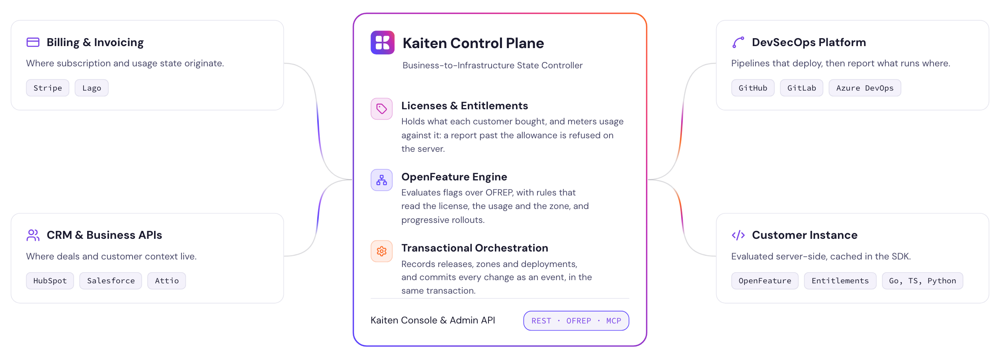

# Kaiten

**The open-source control plane for B2B SaaS.** Kaiten keeps one model of what
each customer bought, what they can use and what runs for them: licenses,
entitlements and usage, feature flags and releases. Your product reads it over
REST, read-only GraphQL or OpenFeature (OFREP), with SDKs for Go, TypeScript and
Python; your team works in the console or the CLI. This repository is the
engine — the Go API, the React console, the event pipeline and the Helm
charts — under Apache 2.0. Self-host it, or join the private beta of Kaiten
Cloud, which runs it for you.

<picture>
  <source media="(prefers-color-scheme: dark)" srcset=".github/assets/control-plane-dark.png">
  
</picture>

[Website](https://kaiten.sh) · [Documentation](https://docs.kaiten.sh) ·
[Self-hosting guide](https://docs.kaiten.sh/docs/self-hosting) ·
[API reference](https://docs.kaiten.sh/docs/api-reference)

## What Kaiten does

- **Licenses and entitlements.** What each customer bought, as versioned
  licenses and the quotas, limits and switches they grant.
- **Usage.** Your product reports what each instance consumes; Kaiten checks it
  against the grant and warns before a limit is reached.
- **Feature flags.** Targeting rules that can read the customer's license and
  entitlements, evaluated over OpenFeature.
- **Releases and deployments.** Which version runs where, for whom, across your
  deployment zones.
- **One audit trail.** Every change and every evaluation, attributed.

The [documentation](https://docs.kaiten.sh) explains the model, from
[what Kaiten is](https://docs.kaiten.sh/docs/introduction/what-is-kaiten) to the
[editions](https://docs.kaiten.sh/docs/introduction/editions).

## Get started

| You want to | Go to |
| --- | --- |
| Try Kaiten in about ten minutes | [Quickstart](https://docs.kaiten.sh/docs/get-started/quickstart) |
| Run it on your own infrastructure | [Self-hosting guide](https://docs.kaiten.sh/docs/self-hosting) |
| Call it from your product | [SDKs](https://docs.kaiten.sh/docs/developer-resources/sdks) and the [API reference](https://docs.kaiten.sh/docs/api-reference) |
| Work on this repository | [DEVELOPMENT.md](./DEVELOPMENT.md) and [CONTRIBUTING.md](./CONTRIBUTING.md) |

## Quickstart

You need [Task](https://taskfile.dev), Docker, Go and Node 24
([Prerequisites](./DEVELOPMENT.md#prerequisites) has the commands). Then:

```bash
cp .env.example .env   # working values for a local stack
corepack enable        # once, for pnpm
task dev               # the whole stack, demo data and the console
```

Open the console at http://localhost:3000 and pick a seeded user in the dev
auth switcher: no account with any provider is needed. The API answers on
http://localhost:6060.

Other ways to start the stack:

| Task | What it starts |
| --- | --- |
| `task dev` | Stack, demo data and the console. **Start here.** |
| `task quickstart` | The same stack and data, without the console |
| `task up` | The stack with an organization and five users, no product data |
| `task up:bare` | Infrastructure only: the first login creates the organization |
| `task down` · `task reset` | Stop the stack · start again from an empty database |

`task --list` shows every task. Ports, a second stack side by side,
authentication, the services and the environment are in
[DEVELOPMENT.md](./DEVELOPMENT.md).

## Repository layout

| Directory | What |
| --- | --- |
| [api](./api/) | The Go API: server code in `api/internal/`, binaries in `api/cmd/`, importable packages in `api/pkg/` |
| [app](./app/) | The console (React and TypeScript); its documentation starts at [`app/docs`](./app/docs/README.md) |
| [packages](./packages/) | Shared frontend packages (theme tokens, API codegen) |
| [charts](./charts/) | Helm charts for Kubernetes |
| [docker](./docker/) | Docker Compose configuration (Envoy, RabbitMQ, Dapr…) |

The SDKs and the CLI have their own repositories:
[sdk-go](https://github.com/kaitencloud/sdk-go),
[sdk-js](https://github.com/kaitencloud/sdk-js),
[sdk-python](https://github.com/kaitencloud/sdk-python) and
[cli](https://github.com/kaitencloud/cli).

Outbound webhooks are a Kaiten Cloud feature. A self-hosted deployment consumes
the same events from the event pipeline (outbox → Debezium → RabbitMQ); see
[Consuming events](https://docs.kaiten.sh/docs/self-hosting/consuming-events).

## Contributing

Issues and pull requests are welcome. [CONTRIBUTING.md](./CONTRIBUTING.md) has
the checklist to run before a pull request, the commit conventions and the
release process; [AGENTS.md](./AGENTS.md) describes the layout, the commands and
the rules, for coding agents and for people.

```bash
task dev    # a working stack and console
task test   # every test: backend, frontend and charts
task lint   # every linter, with --fix
```

## License

Kaiten is open source and licensed under the
[Apache License, Version 2.0](./LICENSE). By contributing, you certify your
contribution under the [Developer Certificate of Origin 1.1](./DCO.md).

The Kaiten name, logos and other brand assets are not licensed under
Apache-2.0. See [TRADEMARKS.md](./TRADEMARKS.md).
